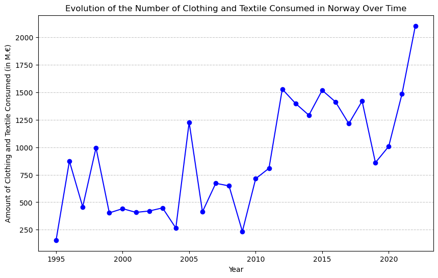
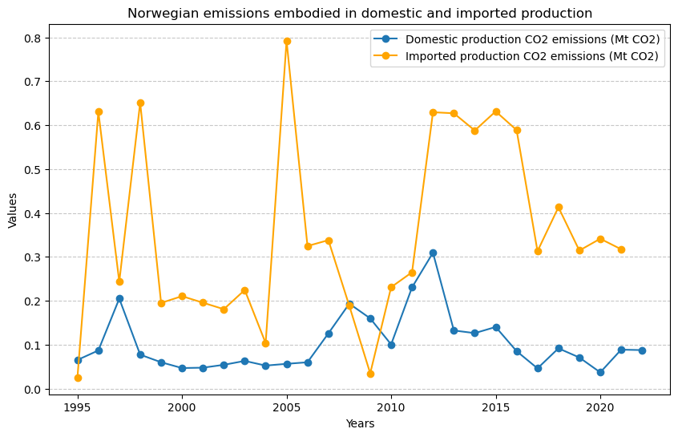
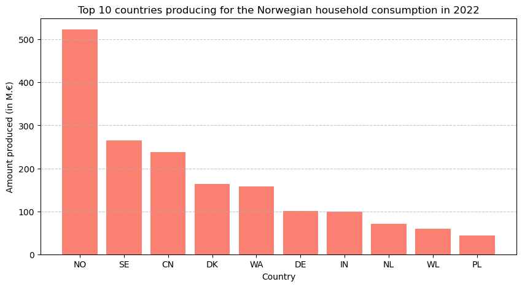
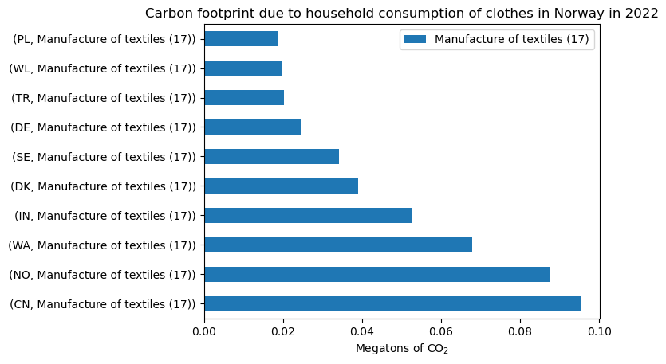

# The Growing Footprint of Fashion in Norway

**Environmentally-extended multi-regional input–output (EE-MRIO) analysis of Norwegian clothing consumption, 1995–2022**

Course project for **TEP4222 – Input-Output Analysis, Trade and Environment** at **NTNU** (Norwegian University of Science and Technology), spring 2025. Final grade: **A**.

---

## Overview

Norway has one of the highest per-capita consumption levels in the world. This project uses the global MRIO database **EXIOBASE 3 (v3.9.5)** to quantify how the rise of fast fashion has changed Norwegian textile consumption and its environmental footprint between 1995 and 2022.

**Research question:** How has the rise of fast fashion affected Norwegian textile consumption and related environmental impacts?

1. Where is the clothing consumed in Norway produced, and how has this changed since 1995?
2. How has the footprint of fashion evolved for **carbon emissions, land use and water consumption**?
3. How do impacts embodied in **domestic production** compare with impacts embodied in **imports**?

## Key findings

- Rising consumption remains an important driver of the environmental pressure of the clothing system.
- Production has shifted from Norway to foreign producers (China and others), so a growing share of the impacts is **embodied in imports**: emissions are externalized.
- Domestic production appears to have become more efficient and less polluting.

| Norwegian textile consumption over time | Domestic vs. imported CO₂ emissions |
|:---:|:---:|
|  |  |

| Origin of clothes consumed in Norway (2022) | Carbon footprint by producing country (2022) |
|:---:|:---:|
|  |  |

📄 Full report: [`report/Final_report_TEP4222_Group2.pdf`](report/Final_report_TEP4222_Group2.pdf)

## Methods

- **Data:** EXIOBASE 3 v3.9.5, industry-by-industry (ixi) tables, 1995–2022 (49 regions × 163 industries).
- **Leontief model:** technical coefficients `A = Z·diag(x)⁻¹`, Leontief inverse `L = (I − A)⁻¹`, final demand `Y` of Norwegian households (textiles sector).
- **Footprints:** stressor intensities `S = F·diag(x)⁻¹`, multipliers `M = S·L`, consumption-based footprints for CO₂ (combustion, air), land use and water consumption (land data available until 2021).
- **Contribution analysis:** top producing countries and top upstream sectors, direct vs. total (footprint) effects.
- **Domestic vs. imported:** split of embodied impacts by producing region.
- The matrices are parsed **without `pymrio`** (not allowed in the course): see [`extraction_data.py`](extraction_data.py).

**Stack:** Python 3.12 · pandas · NumPy · Matplotlib · scikit-learn · Jupyter

## Repository structure

```
├── project.ipynb          # Full analysis (parts 1–3), with all figures
├── extraction_data.py     # Parsers for the EXIOBASE Z, Y, x and F matrices
├── data_processed/        # Aggregated results exported by the notebook (.xlsx)
│   ├── Part 1/            #   production & consumption, origin of clothes
│   ├── Part 2/            #   top impact sectors and countries
│   └── Part 3/            #   CO₂, land and water, domestic vs. imported
├── figures/               # Key figures used in this README
├── report/                # Final report (PDF)
└── requirements.txt
```

## Reproducing the analysis

The notebook can be **read directly on GitHub** (all outputs are saved). To re-run it:

1. Download EXIOBASE 3 v3.9.5 (ixi tables, 1995–2022) from Zenodo: <https://doi.org/10.5281/zenodo.14869924>
2. Extract it into a `data/` folder at the project root, so that the files follow `data/IOT_<year>_ixi/...`
3. Install the dependencies and launch Jupyter from the project root:

```bash
pip install -r requirements.txt
jupyter notebook project.ipynb
```

> The raw EXIOBASE files (several GB) are not included in this repository.

## Authors

- **Léo Liberkowski** – coding, methodology, findings
- **Lena Dehli Krebs** – conceptualization, literature review, discussion, report writing

## Data & license

- Code: MIT License (see [`LICENSE`](LICENSE)).
- Data: derived from EXIOBASE 3 (Stadler et al., 2018, *Journal of Industrial Ecology*, doi:[10.1111/jiec.12715](https://doi.org/10.1111/jiec.12715)), used for non-commercial academic purposes under the EXIOBASE licence. The files in `data_processed/` are aggregated results, not the original database.
